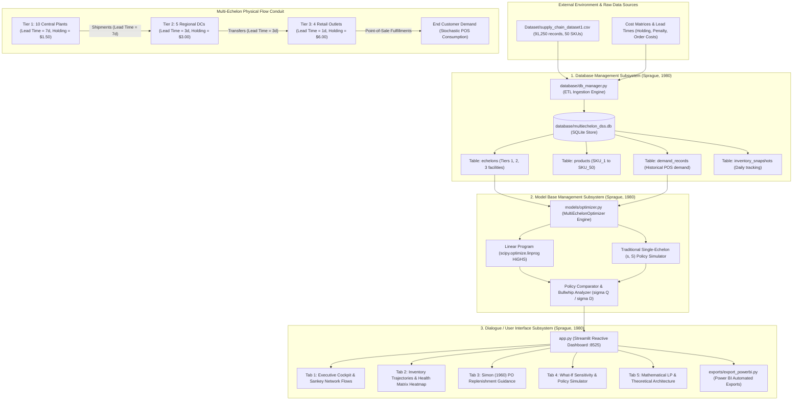
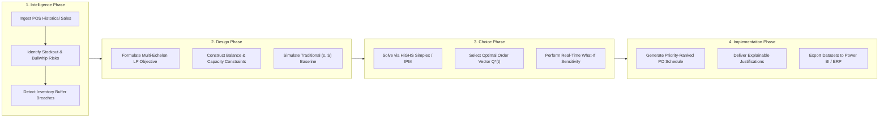

# MultiEchelonDSS — System Architecture Specification

## 🏛️ Sprague (1980) Three-Subsystem DSS Framework

This Decision Support System (DSS) follows the classical **Sprague (1980)** tripartite architecture, integrating **Data Management**, **Model Management**, and **Dialogue (User Interface)** subsystems to solve multi-echelon inventory allocation under stochastic demand.

---

## 🔄 Herbert Simon (1960) Four-Phase Decision Process

---

## 📦 Subsystem Component Matrix

| Subsystem | Primary Code File | Key Functions / Responsibilities |
| :--- | :--- | :--- |
| **Data Management** | `database/db_manager.py` `database/schema.sql` | Schema creation, ETL from CSV, dynamic parameter querying, horizon slicing. |
| **Model Management** | `models/optimizer.py` | Multi-echelon linear program formulation, sparse matrix assembly, HiGHS solver invocation, $(s,S)$ traditional simulation, Bullwhip variance ratio calculation. |
| **Dialogue Subsystem** | `app.py` `exports/export_powerbi.py` | Dark cyber-glass UI, Plotly Sankey flow charts, heatmap health matrices, what-if sliders, CSV operational schedules. |

