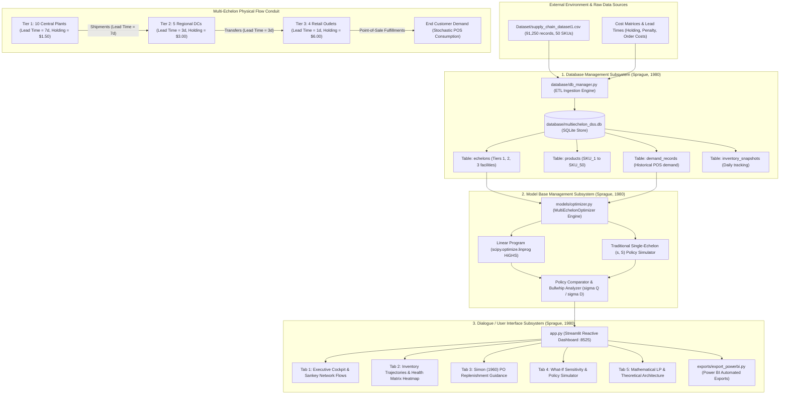
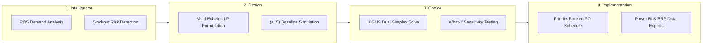

# MultiEchelonDSS — Multi-Echelon Inventory & Distribution Optimization DSS

[](https://python.org)
[-purple.svg)](https://misq.umn.edu)
[](https://streamlit.io)

Decision Support System combining mathematical optimization models (Linear Programming / HiGHS) and interactive dashboards to optimize multi-tier replenishment quantities and shipping schedules under uncertain demand.

---

## 🏛️ Sprague (1980) DSS Architecture



### 🔄 Herbert Simon (1960) Decision Process



| DSS Subsystem | Implementation in Project | Description |
| :--- | :--- | :--- |
| **Database Subsystem** | `database/schema.sql`<br>`database/db_manager.py` | SQLite store managing 3-tier facilities (Supplier, RDC, Retail), historical demand records, lead times, and cost matrices. |
| **Model Base Subsystem** | `models/optimizer.py` | Multi-echelon Linear Program (`scipy.optimize.linprog`) minimizing total supply chain holding, ordering, and stockout penalty costs while mitigating the Bullwhip Effect. |
| **User Interface Subsystem** | `app.py`<br>`index.html`<br>`exports/` | Interactive Streamlit executive cockpit, scenario simulation sliders (demand shocks, lead time delay), and automated Microsoft Power BI dataset exports. |

---

## 📁 Repository Structure

```
DSS Project/
├── index.html                 # Interactive Proposal Presentation Webpage
├── main.py                    # Master Pipeline Orchestrator (CLI)
├── app.py                     # Streamlit Interactive DSS Web Dashboard
│
├── Dataset/
│   └── supply_chain_dataset1.csv # Real Supply Chain Dataset (91,250 records, 50 SKUs)
│
├── database/
│   ├── schema.sql             # Relational SQLite schema definition
│   ├── db_manager.py          # ETL, real dataset ingestion engine
│   └── multiechelon_dss.db    # SQLite Database File
│
├── models/
│   └── optimizer.py           # Linear Programming Multi-Echelon Solver
│
└── exports/
    ├── export_powerbi.py      # Automated Power BI dataset export engine
    ├── powerbi_inventory_flows.csv
    ├── powerbi_kpi_summary.csv
    └── powerbi_replenishment_schedule.csv
```

---

## 🚀 Quickstart Guide

### 1. Run the Full Optimization Pipeline
Execute the end-to-end DSS pipeline (Database setup → Optimization solver → KPI report → Power BI CSV export):

```bash
python main.py
```

Optional CLI flags:
```bash
python main.py --sku SKU_1 --horizon 30 --reseed
```

### 2. Launch the Interactive Decision Support Cockpit (Streamlit)
Launch the modernized, enterprise Streamlit decision-maker cockpit with real-time what-if scenario simulation, interactive Sankey network flows, and Sprague (1980) theoretical frameworks:

```bash
python run.py
```
*(Or double-click `run.bat` on Windows — automatically opens `http://localhost:8525` in your browser)*

### 4. Open the Proposal Architecture Showcase
Double-click or open [index.html](file:///c:/Users/Koushik%20Raj%20Singh/Desktop/DSS%20Project/index.html) in any modern browser for the visual proposal overview.

### 4. Power BI Integration
1. Open Microsoft Power BI Desktop.
2. Select **Get Data** → **Text/CSV**.
3. Import the files from `exports/`:
   - `powerbi_inventory_flows.csv`: Time-series inventory and order comparisons.
   - `powerbi_kpi_summary.csv`: Cost savings and bullwhip ratio cards.
   - `powerbi_replenishment_schedule.csv`: Actionable purchase orders and transfer schedules.

---

## 📈 Optimization Model Formulation

The Model Base Subsystem minimizes total supply chain cost across $E$ echelons over planning horizon $T$:

$$\min \sum_{t=1}^T \sum_{e=1}^E \left( h_e \cdot I_{e,t} + s_e \cdot S_{e,t} + o_e \cdot \mathbf{1}_{\{Q_{e,t} > 0\}} \right)$$

Subject to:
- **Inventory Balance:** $I_{e,t} - S_{e,t} = I_{e,t-1} - S_{e,t-1} + Q_{e, t - L_e} - D_{e,t}$
- **Downstream Linking:** Demand at Tier $e$ equals replenishment orders from Tier $e+1$.
- **Non-negativity & Capacity:** $0 \le I_{e,t} \le \text{Capacity}_e$, $Q_{e,t} \ge 0$, $S_{e,t} \ge 0$.

---

## 📚 References
1. **Sharda, R., Delen, D., & Turban, E.** (2020). *Analytics, Data Science, & Artificial Intelligence: Systems for Decision Support* (11th ed.). Pearson.
2. **Power, D. J.** (2002). *Decision Support Systems: Concepts and Resources for Managers.* Quorum Books.
3. **Sprague, R. H.** (1980). A framework for the development of decision support systems. *MIS Quarterly, 4*(4), 1–26.
4. **Chopra, S.** (2019). *Supply Chain Management: Strategy, Planning, and Operation* (7th ed.). Pearson.
5. **Silver, E. A., Pyke, D. F., & Thomas, D. J.** (2016). *Inventory and Production Management in Supply Chains* (4th ed.). CRC Press.
